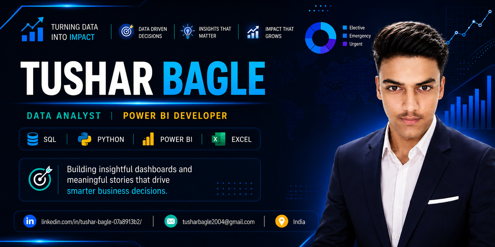

<!-- ===================== PROFILE BANNER ===================== -->

<p align="center">
  
</p>

<h1 align="center">Hi 👋, I'm Tushar Bagle</h1>

<h3 align="center">
  Data Analyst • Power BI Developer • SQL • Python
</h3>

<p align="center">
  <strong>Building dashboards that turn data into business insights.</strong>
</p>

<p align="center">
  <a href="https://github.com/TusharBagle">
    
  </a>
  <a href="https://www.linkedin.com/in/tushar-bagle-07a8913b2/">
    
  </a>
  <a href="mailto:tusharbagle2007@gmail.com">
    
  </a>
  <a href="https://www.kaggle.com/tusharbagle">
    
  </a>
</p>

---

# 👨‍💻 About Me

I'm **Tushar Bagle**, a Data Analyst from India passionate about transforming raw data into meaningful business insights.

🎓 **B.Tech in Computer Science & Engineering**  
🏫 **Vidhyadeep University**  
📅 **2025 – 2029**

### 🔹 My Focus

* 📊 Power BI Dashboard Development
* 🗄️ SQL & Database Analysis
* 🐍 Python for Data Analysis
* 📈 Excel Data Analysis
* 📉 Data Visualization
* 🧹 Data Cleaning & Transformation
* 📐 DAX & Data Modeling
* 💡 Business Intelligence
* 🚀 Advanced Data Analytics

### 🎯 My Goal

To build **impactful dashboards and data solutions** that solve real-world business problems and help organizations make data-driven decisions.

---

# 🛠️ Tech Stack

### 📊 Data Analytics & Visualization

<p>
  
  
  
</p>

### 🐍 Python

<p>
  
  
  
</p>

### 🔧 Tools

<p>
  
  
  
</p>

---

# GitHub Activity & Streak

<p align="center">
&#x20;
  
&#x20;
</p>

--- 

# 📊 My Data Analytics Workflow

```text
               RAW DATA
                  │
                  ▼
         ┌─────────────────┐
         │ Data Cleaning   │
         └────────┬────────┘
                  │
                  ▼
         ┌─────────────────┐
         │ Data Transform  │
         └────────┬────────┘
                  │
                  ▼
      ┌─────────────────────────┐
      │ Excel • SQL • Python    │
      └────────────┬────────────┘
                   │
                   ▼
         ┌─────────────────┐
         │ Data Modeling   │
         └────────┬────────┘
                  │
                  ▼
         ┌─────────────────┐
         │    Power BI     │
         │    Dashboard    │
         └────────┬────────┘
                  │
                  ▼
         ┌─────────────────┐
         │ Business        │
         │ Insights        │
         └─────────────────┘
